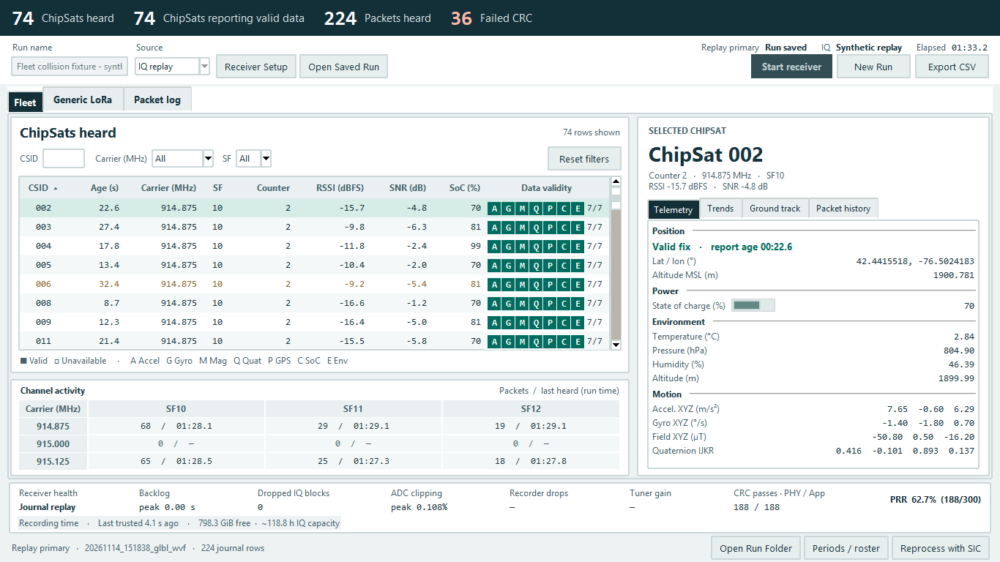

# DeSCENT LoRa fleet receiver

Windows receiver for one RTL-SDR. One 1 MS/s CU8 stream feeds SF10, SF11 and SF12 searches on each selected carrier. Live reception records IQ by default. File and live modes use the same decoder.

## Field hardware

Connect the antenna to the Nooelec LaNA input and its output to the RTL-SDR. Power the wideband LaNA from USB. The receiver never enables the dongle's bias tee. A separately managed rtl_tcp server should also start with antenna-port power off. **Receiver Setup → Front end** offers LaNA (20 dB), LaNA WB (19 dB), antenna direct and Custom. Both LaNA presets specify USB power and no filter. Choose Custom to record a particular USB supply, filter or measured gain. The main window shows the active front end beside tuner gain. Old IQ without hardware metadata displays “Front end not recorded.” [Nooelec LaNA](https://www.nooelec.com/store/lana.html)

The GUI and CLI share a local hardware choice. The first launch uses the field LaNA. `fleet.py live --front-end lana|lana-wb|none` selects a preset. Explicit `--lna-*`, `--rf-filter` and `--usb-supply` flags override individual fields. A changed front end with fixed gain prompts a reminder to rerun Auto Set. The comparison uses the last live run that actually received IQ. Replays use the recording's metadata.

Auto Set logs the applied tuner gain and warns at minimum gain. An external LNA can reduce the tuner gain needed and amplify out-of-band interference. Compare runs at documented gains and USB supplies. RSSI and channel noise are in ADC-referenced dBFS. A sustained increase in the measured channel floor can accompany interference or front-end desensitization even with zero rail hits.

**RF diagnostics** displays capture-band power and branch counts for sync, accepted, rejected and unstable headers, PHY CRC passes/failures and trusted packets. Decode attempts from both SIC passes contribute to acquisition counts. Packet counts use the merged journal. TX truth supplies the denominator for missed transmissions. The waterfall shows the most recent minute. `rf_diagnostics.csv` stores the full capture-time series with frequency bins ascending from center minus half the sample rate. Each half-second row averages 32 spaced Hann periodograms for the waterfall. The channel readouts show the 20th percentile over ten seconds, in dBFS over one channel bandwidth.

The broadband alarm measures unused spectrum beyond all carrier bandwidths and CFO margins, excluding DC and the outer 10% on each side of the capture. A 1.5-second low-percentile estimate detects sustained rises of 5 dB. The alarm clears when both the fast and ten-second estimates fall below a 4 dB rise. The reference uses quiet observations from the first 30 seconds at each tuner gain. A half-second row needs at least eight usable FFTs to update the alarm. This prevents sustained ADC clipping from depressing the reference or clearing an active alarm. Profiles covering all usable bins use the ten-second in-channel estimate. The RF panel, CSV and summary identify that fallback. The existing per-carrier `raised` fields mirror the shared alarm. A rising alarm triggers a `noise_floor_rise` IQ clip. [Measured warning counts and response times](validation/rf_diagnostics_20261116/README.md)

During live and replay, `events/` saves original CU8 around rail hits, rejected or unstable headers, and broadband noise rises, including when full IQ recording is off. Each sidecar gives the trigger, decoder pass and half-open sample range on the parent capture clock. Clips include up to two seconds before and one second after each trigger. Gaps and capture endpoints shorten clips. Each kind has a 30-second cooldown and a six-clip limit per rolling capture hour across both passes. Clips and their sidecars share a 1 GB budget per run. **Receiver Setup → Files**, `--event-iq-per-kind-hour` and `--event-iq-max-mb` adjust the limits. A zero limit disables event captures. The summary counts skipped captures by reason. The waterfall and rail counts use the original primary input.

## First run in PowerShell

```powershell
Set-Location "$HOME\Desktop\DeSCENT_Comms\LoRa_SDR_Reciever"
.\setup.bat
.\run_gui.bat
```

For a first run without an SDR, open the bundled IQ in the same interface. In **Receiver Setup → Files**, select `tests/nine_branch_profile.json` to monitor all three carriers in this historical fixture, then click **Start receiver**.

```powershell
.\run_gui.bat --replay .\examples\epfl_bench.iq
```

The example lasts 10.25 seconds. The first three packets are CSID 1 at SF10, CSID 2 at SF11, and CSID 3 at SF12. CSIDs 2 and 3 then start together on carrier A. These are receiver-archive payloads modulated by the independent EPFL transmitter.

## At the bench

For a calibrated comparison against an SX1276 receiver, use the [splitter procedure and paired log scorer](docs/splitter-benchmark.md).



**ChipSats heard** counts each distinct ID once per run after both the LoRa PHY CRC and the DeSCENT application CRC pass. **ChipSats reporting valid data** counts IDs whose latest trusted packet by capture time has any of the seven sensor-group bits set in the flight validity byte (`validity_raw & 0x7F`). **Packets heard** counts all journaled frames, including generic, CRC-absent and failed frames. **Failed CRC** is the subset with an explicitly failed PHY or application CRC, counted once per frame. All four totals cover the whole run across filters and Clear View.

- Choose **Live RTL-SDR** or **IQ replay**, then pick a **Monitoring profile** on the main screen. Each preset enables SF10, SF11 and SF12 on every selected carrier. For a single-SF bench test, choose **915 MHz only** and adjust the SF checkboxes in **Receiver Setup → Radio**. The Files tab selects a receiver configuration file, replay recording and output folder.
- For live reception, select **Record IQ** to save `capture.iq` and its sidecar in the run folder. The packet journal is written for either recording setting. **Auto-set gain on start** scans the tuner, then checks the selected gain over two seconds. If a stronger burst arrives, it lowers gain and measures again, with up to three checks in total. To use a fixed gain of your choice, clear **Auto-set gain on start** and enter **Manual gain (dB)**. Gain stays fixed during capture. The run summary records the gain and any checks, and the IQ sidecar records the applied gain.
- Click **Start receiver**. The run bar shows recording or playback state and the capture clock. The health strip shows the DSP backlog, local IQ drops, ADC rail hits, applied gain and both CRC pass counts. Unpaced replay displays processing speed relative to real time. Each carrier/SF cell shows the number of decoded packets and the most recent preamble start on the capture clock.
- **Last Heard** shows how many seconds ago each ChipSat’s latest trusted packet started on the capture clock. Click the heading to bring the most recently heard ChipSats to the top. The row also shows carrier, SF, transmitted counter, RSSI (dBFS), and estimated SNR (dB). The selected ChipSat's inspector shows the same packet readings. SoC can carry forward from an earlier valid reading, including 0%. The validity squares follow flight bits 0–6 in order: **A** accel, **G** gyro, **M** magnetometer, **Q** quaternion, **P** GPS, **C** SoC, **E** environment. A filled square marks a set bit and an outline marks a clear bit. A dash means the measurement is unavailable. Sort any numeric column or filter by channel while keeping a visible ChipSat selected.
- **Packet history** contains the latest 12 trusted packets for the selected ID and copyable payload hex. **Packet log** holds a 300-row diagnostic display including rejected and CRC-absent frames. **Generic LoRa** displays one line per positive PHY CRC, including unrelated 55-byte payloads. It preserves every byte in hex and escapes nonprintable characters in the text preview. Both tabs support pause-autoscroll and clear view.
- **Export CSV** defaults to every packet committed through the most recent receiver update. It also supports current filters, selected-ChipSat history, the fleet summary and SIC-only recoveries. Generic LoRa exports all PHY-valid packets matching its carrier/SF filters. Clearing or scrolling the screen leaves the journal and exports intact. The footer gives the export path and opens its folder.
- **Stop receiver** finishes the current run. **New Run** also works during capture or export. It waits for outstanding work, creates a new run ID and folder, and resets fleet, log, filters, PRR and counters. Radio and recording settings carry over. Earlier recordings and exports remain in their original folders.

### Coverage and storage

Under **Receiver Setup → Fleet & station**, choose Mission (100 IDs, target 80) or Bench (2 IDs, target 2). Both start with 30-second periods. Edit the size, target or period for another test. For a roster, load a CSV with a distinct `chipsat_id` per row and optional `carrier_hz,sf`. Coverage then counts the expected IDs. Select a period in **Periods / roster** to see its heard count, valid GPS reports and target outcome. With a roster, the list gives missing IDs, their last observations through that period and their assignments. Without a roster it lists observed IDs.

Pass the same CSV with `--roster` on the live or replay CLI. At startup, the receiver warns about a disabled roster SF, a roster carrier farther than `max_cfo_hz - 2000` Hz from every monitored carrier, and any monitored pair spaced less than 200 kHz apart. The GUI shows a nonmodal dialog, the CLI writes to stderr, and `summary.json` retains the warnings. The operator controls tuning.

The receiver discovers preambles from IQ on every configured branch. Coverage uses each packet’s measured preamble start. A boundary waits for the detector’s remaining preamble search history and pending bursts to clear. Initial/final partial periods and known sample gaps are marked. An optional period epoch is a reporting origin in capture seconds. Sidecars can supply `mission_epoch_capture_s`, `tx_epoch_capture_s`, or an offset-aware UTC epoch and recording start. With no origin the display reads **capture-aligned**. **Score with TX log** uses the supplied transmit record after decoding and reports matched/offered PRR. A transmit record is never required for reception.

The top-right light turns green and reads **Listening** when live IQ blocks arrive, even on a quiet RF channel. It stays red while waiting for the first block, shows **IQ stalled** after 1.5 seconds without another block, and reads **Not listening** when stopped or using replay. Live health shows the time since the last IQ block and the last trusted packet separately. Free space and approximate remaining recording hours use the selected drive, the 2 MB/s CU8 rate and the recorder’s disk reserve. Replay time, packet ages and periods follow the recorded sample clock through faster playback, pause and gaps.

### Inspect and compare

- **Trends** opens on received preamble power in dBFS. Choose a sensor, CFO or both altitude references. A point opens its packet details. Use the mouse wheel or +/− to zoom and drag horizontally to pan. **Follow latest** restores scrolling. The plot uses actual observations, leaves gaps at invalid readings and samples dense views with bounded disk-index queries. The temporary index is built from the packet journal and released on New Run. [Recorded-bench time history](docs/field-trends.png)
- **Ground track** projects valid positions onto one shared east/north plane in meters. The origin is the configured station or the first valid fix in capture-time order across the run. Ground footprints use WGS84 at ellipsoid height zero. The GPS altitude readout remains MSL. Equal axis scales, direction arrows and first/latest markers work offline. DeSCENT V2.5 carries GPS validity without a fix timestamp, so coverage counts valid reports and age refers to the last valid report. Journals carrying `gps_fix_capture_s`, `gps_fix_age_s` or a comparable `gps_fix_utc` retain the measurement age. The local projection implements the geocentric-to-topocentric method independently. [Track screenshot](docs/field-track.png) · [PROJ topocentric method and EPSG 9837](https://proj.org/en/stable/operations/conversions/topocentric.html)
- **Generic LoRa** shares the receiver and current journal. Its carrier/SF selectors, copyable hex and byte-exact CSV export work during capture and when inspecting a saved run. **Packet log** keeps the independent PHY and application CRC outcomes. [Generic payload screenshot](docs/field-generic.png)
- **Open Saved Run** reads a completed folder’s journal. **Reprocess with SIC** runs a cancellable offline replay using the original saved IQ and RF profile. A new analysis folder contains its journals, scores when the original TX record can be verified, an SIC-only CSV and a per-period comparison. The comparison shows added IDs and newly attained targets. For an earlier interrupted capture it compares the common recorded time span. **Open Run Folder** opens the active primary or analysis directory.

For the archived two-radio bench test, use either command below. The first opens the journal directly. The second decodes the original recording after you press **Start receiver**.

```powershell
.\run_gui.bat --bench --open-run .\runs\20261112_162107_mc3rlsbi
.\run_gui.bat --bench --replay .\runs\20261112_162107_mc3rlsbi\capture.iq
```

Run the UI and PHY tests with `.\run_acceptance.bat --quick`. Run `.\run_acceptance.bat --field` for the generated two-radio payload/GPS fixture and the separate three-period 30/12/8 load test. The full original acceptance command below still exercises the random-phase collision fixture. [Measured field results](VALIDATION.md)

Setup uses Python 3.11+ with Tk on Windows and a project-local virtual environment. It checks for usable installed packages first. If required it installs the packages in `requirements.txt` into that environment. This installation was exercised with Python 3.13.17, NumPy 2.5.4, SciPy 1.18.1 and lora-phy 0.3.0. For live use, install the RTL-SDR USB driver and an `rtl_tcp.exe` compatible with your device. The launcher finds it on PATH, in radioconda, or at the path in `RTL_TCP_EXE`. `receiver.bat doctor` prints the resolved executable. Each local live run starts and owns its own localhost server. Use `--connect HOST:PORT` only for a server you intend to tune and control.

```powershell
.\run_live.bat --gain 10 --ppm 0 --seconds 45
.\run_acceptance.bat --quick
.\run_acceptance.bat
```

**Quick** runs the software tests, the EPFL fixture and nine concurrent transmissions. Full acceptance also generates the signed power sweep and the 100-node fleet, runs paired SIC comparisons, and paces the same fleet IQ through a local TCP socket. Allow about 1 GB of free space for its fixtures and recording. The full run needs permission to use loopback TCP. To repeat just the paced stage, use `run_acceptance.bat --paced-from <acceptance-folder>`. It uses the profile saved with that run. [Measured acceptance results](VALIDATION.md)

## Carrier and tuner frequencies

The main screen and **Receiver Setup → Radio** offer three named presets and **Custom**. Each named preset tunes the SDR to 915.000 MHz and enables SF10–12 on every listed carrier. In two operator measurements, the RTL DC spike added 0.1–0.25 dB of noise integrated over a 125 kHz channel at that center. A new installation starts on **Fleet A/B**. The GUI and CLI remember the last carrier selection.

| Preset | Monitored carriers (MHz) | Decoder branches |
|---|---|---:|
| 915 MHz only | 915.000 | 3 |
| Fleet A/B | 914.875, 915.125 | 6 |
| Four-carrier | 914.7, 914.9, 915.1, 915.3 | 12 |
| Custom | Operator-selected carriers, including the original three-carrier set | Depends on carriers and SFs |

Choosing a preset restores its carriers and all three SFs. **Receiver Setup → Radio** offers individual carrier and SF checkboxes and an **Additional MHz** field for other frequencies. **New Run** carries your current settings forward and lets you edit them before starting again. [Main screen with the four-carrier preset and manual gain](docs/monitor-controls.png)

During replay the saved IQ profile takes priority over the remembered preset. Older run folders supply it from the adjacent `summary.json`. Select a different preset or pass explicit settings to analyze other branches within the recorded band.

**Tuner center (MHz)** sets the live capture frequency. At 1 MS/s, the four-carrier preset leaves 119.5 kHz to each capture edge after including the 125 kHz channel bandwidth and ±18 kHz CFO allowance. Replay uses the IQ sidecar’s actual tuning when present and checks that all requested channels fit. Without a recorded center, the tuner center field supplies it. The CLI accepts the same carrier frequencies in Hz.

```powershell
.\run_live.bat --preset "Fleet A/B"
.\run_live.bat --preset Four-carrier
.\run_live.bat --preset "Fleet A/B" --max-cfo-hz 28000
.\replay_iq.bat .\examples\epfl_bench.iq --preset Custom --carriers 914875000 915000000 915125000
```

**RF diagnostics** shows each carrier’s packet count, median CFO and 5th–95th percentiles over the last ten capture minutes. These use PHY-CRC-valid packets, including generic LoRa, and exclude packets marked `suspect` for timing. The per-branch **Suspect timing** count also appears as `suspect_packets` in `summary.json`. The main window warns when the median magnitude exceeds 10 kHz or the 95th percentile of absolute CFO reaches the outer 4 kHz of the configured search. The panel and `summary.json` show the suggested change to tuner ppm. Verify against a known reference before applying it manually. A common transmitter offset can move the median. [28 kHz measurements and recorded-IQ investigation](validation/fleet_operations_20261116/README.md)

**Live reconnect** starts on EOF, a socket error, or three seconds without IQ. The GUI shows **Reconnecting…** and the dropout count. The CLI logs each attempt. Retries wait 1, 2, 5 and then 10 seconds between attempts until reception resumes or the run ends. A locally owned rtl_tcp process restarts. An external server reconnects at the same address. Tuning, sample rate, ppm and the selected tuner gain are restored on each connection. Auto Set runs during initial gain setup.

The CU8 file contains received sample pairs. A dropout ends the decoder segment, and the next segment starts on the original capture clock at the wall time of resumed IQ. `capture.iq.json` stores the byte offset and missing byte count in `gaps`, plus a `source_dropouts` list shared with the summary. Each entry includes the logical start and end samples, corresponding UTC times, duration, reason, attempt count and whether IQ resumed. Replay advances the same clock across missing samples. USB loss upstream of rtl_tcp still has no sequence counter.

## Radio settings and scope of confirmation

| Setting | First bench profile |
|---|---|
| Tuner and capture | 915.000 MHz, 1,000,000 complex samples/s, unsigned 8-bit I then Q |
| Default monitored carrier centers | 914.875 and 915.125 MHz |
| Fleet transmit allocation | 50 ChipSats each on A (914.875 MHz) and B (915.125 MHz), split 30/12/8 across SF10/11/12. The center channel has no assigned fleet nodes. |
| Occupied bandwidth | 125 kHz on each carrier |
| Sync / polarity | 0x12, normal IQ |
| Header / expected coding | Explicit, 4/7, PHY CRC enabled |
| Preamble | 8 unmodulated upchirps |
| LDRO | Auto, off at SF10 and on at SF11 and SF12 |
| CFO search | ±18 kHz per carrier by default. Receiver Setup → Radio and `--max-cfo-hz` accept 10000–30000 Hz. |

The nominal occupied edges are 914.8125 and 915.1875 MHz. Capture edges are 914.500 and 915.500 MHz. Startup also checks each channel's CFO search margin. The RF frequencies and allocation are the operator's proposed plan. The bench PHY settings agree with the available RF Lab LoRa presets and were exercised with the independent transmitter. An earlier live capture logged seven SF11 and 21 SF12 packets on 915.000 MHz passing both CRCs. Flight register readback remains open. The explicit header supplies the received CR, payload length and PHY CRC presence for each frame. Sync is checked from IQ. Preamble length, header mode, LDRO and polarity are configured assumptions. [Live bench summary](runs/20261112_152240_6l7w8vt8/summary.json)

For physical confirmation, export one row per actual transmitter configuration, covering A and B at all three SFs. Add the center carrier through Custom when monitoring a bench transmitter there. Use measured/read-back values for the columns below. `ldro` is the effective Boolean at that SF. Use 0x-prefixed hexadecimal or decimal for `sync_word`.

```csv
carrier_hz,sf,bandwidth_hz,sync_word,explicit_header,phy_crc,cr_denominator,preamble_symbols,ldro,invert_iq
```

```powershell
.\receiver.bat check-tx C:\RF_runs\radio_readback.csv
```

An incomplete or mismatched readback produces a nonzero exit and names the missing branches or differing fields. Edit a copy of [the profile](profiles/descent.json) for other settings. Both the GUI and CLI accept the copy. `--center`, `--carriers`, `--sfs` and `--bw` override a profile for a single run. This command listens to SF11 and SF12 on carrier A.

```powershell
.\run_live.bat --profile .\profiles\descent.json --carriers 914875000 --sfs 11 12 --gain 10
```

The decoder accepts SF7–SF12, integer Fs/(2·BW), implicit or explicit headers, CR 4/5–4/8, configurable sync word and polarity. The tested mission bandwidth is 125 kHz. For a different bandwidth, set `max_cfo_hz` to a positive value below BW/4. Oscillator error and Doppler add to the received offset. A contact with predicted offsets above the default needs a wider validated profile or updated tuning. Settings with occupied bandwidth or search margin outside the captured band are rejected.

## Bench acceptance

1. **Read back the radios and obtain a common time reference.** Record radio IDs, per-radio SF, BW, CR, sync, header mode, CRC setting, preamble, LDRO and IQ polarity. Record receiver center, gain, ppm, splitter/attenuator settings, transmit-start log and the offset between TX-log time zero and the first recorded IQ pair. A known isolated reference burst can establish this offset.
2. **Capture isolated controls.** Use carrier A, a known 55-byte payload at each of SF10, SF11 and SF12 and a fresh packet counter per transmission. Start the receiver before the first preamble and leave at least four seconds after the last start. Check the bytes and both CRCs. Also use the generic packet CSV for other payload lengths.
3. **Repeat the demonstrated equal-power comparison.** Put SF11 and SF12 on A, start their preambles together, and keep tuner gain fixed. Use separate transmitter attenuation or calibrated RF-path attenuation to change relative level. Both signals reach the same ADC. Use an initial `--auto-gain` run if desired and then hold the reported gain throughout the comparison. Inspect rail hits during representative bursts.
4. **Sweep relative received power.** At fixed gain capture weaker-alone, stronger-alone and overlapped packets at signed differences 0, ±6, ±12, ±18, ±24 and ±30 dB. Positive means SF11 stronger. Measure each signal alone at the receiver input or estimate its relative level from isolated preambles. Retain only individually decodable weak levels when interpreting masking loss. Repeat each setting with independent phase/start offsets and packet counters. Preserve clips and misses in the record.
5. **Exercise each monitored branch, then the fleet.** Check one known packet on each of the six Fleet A/B branches concurrently. The historical nine-branch acceptance campaign uses its explicit test profile. For the 100-node trial, offer one packet per ChipSat per 30 s using the 30/12/8 split on A and B. Capture at least three complete periods plus leading/trailing margin. Include all offered packets in the transmit CSV. Record for at least 100 s for a 90 s trial and log the capture-to-TX offset. More periods and power realizations are needed for a field recovery estimate.

These commands create a unique live folder, locate its recording and run both decodes on identical IQ. Start the capture before initiating the transmitter sequence. Supply the actual TX CSV and measured clock offset for scoring.

```powershell
.\run_live.bat --gain 10 --ppm 0 --seconds 100 --out .\runs\bench_capture
$captureRun = Get-ChildItem .\runs\bench_capture -Directory | Sort-Object Name | Select-Object -Last 1
$iq = Join-Path $captureRun.FullName 'capture.iq'
.\replay_iq.bat "$iq" --out .\runs\bench_primary
.\replay_iq.bat "$iq" --sic --out .\runs\bench_sic
$primary = Get-ChildItem .\runs\bench_primary -Directory | Sort-Object Name | Select-Object -Last 1
$sic = Get-ChildItem .\runs\bench_sic -Directory | Sort-Object Name | Select-Object -Last 1
$offset = [double](Read-Host 'Seconds from capture start to TX log zero')
.\receiver.bat score "$($primary.FullName)" C:\RF_runs\truth.csv --offset-s $offset
.\receiver.bat score "$($sic.FullName)" C:\RF_runs\truth.csv --offset-s $offset
```

## Capture, replay and exports

Packet rows include `run_id`, `run_name`, `receive_utc` and `timestamp_source`. Live receive UTC uses the host capture start plus the RF sample offset. Replay uses the recorded UTC start when available. For an older recording without that timestamp, `replay_decode_utc` identifies the UTC at which this replay decoded the packet. Use `capture_s` to compare transmissions in every case. GUI exports also flatten valid telemetry into engineering-unit columns and include the parser’s validity flags. Empty CSV cells distinguish unavailable data from a measured zero.

`rssi_dbfs` measures total power relative to ADC full scale in the filtered receive channel during the packet preamble. `snr_db` compares the coherent preamble signal with residual channel power, including noise and interference, before LoRa processing gain. Both use the median across complete preamble chirps. Absolute input power in dBm would require calibration. Replaying saved IQ populates these fields for older journals that only recorded coherent preamble power.

The packet journal appends three timing fields. `timing_check` is `ok` for the original consistent refinement, `refit` for an accepted SFD remeasurement, `fallback` for a corroborated preamble-only estimate, and `suspect` when the receiver cannot substantiate the timing and CFO. A suspect packet retains its payload and CRC results. Treat its timestamp and CFO as provisional. `sync_rail_samples` counts original CU8 sample pairs with either component at 0 or 255, from the reported preamble start through the end of the SFD. `coarse_cfo_hz` records the estimate used at acquisition. Older journals have empty values for these fields when exported. [Timing integrity measurements](validation/timing_integrity_20261116/README.md)

The health strip shows the most recently processed block’s ADC clipping. The live status line shows the peak. The saved summary includes both the peak block fraction and the clipping fraction across the full run. The backlog history retains the latest 4,096 observations for long sessions.

- `capture.iq` is the original RTL CU8 stream. `capture.iq.json` contains tuning, recording byte counts, gaps and SHA-256. The asynchronous recorder receives bytes before the DSP queue. A full DSP queue can therefore lose a live decode while leaving the original recording intact. Disk recorder losses have their own counters. A recording stop/error is recorded in its sidecar and run summary.
- A reference-style `.iq.json` is read automatically. `center_hz` gives actual tuning. Without a sidecar the profile supplies tuning and sample rate. Replay interprets recorder `file_offset` and `dropped_bytes` as byte counts, skips parity padding, resets filters and pending bursts at gaps, and advances the RF clock. Truncated/unpaired samples are unavailable. Pair a recorded file with its own sidecar.
- `packets.csv` includes the original payload bytes as hex, capture-relative preamble start in complex samples and seconds, carrier, SF, parsed coding rate, estimated frequency offset/drift, coherent preamble level in dBFS, both CRC outcomes, CSID, counter and decoded telemetry JSON. Empty CRC indicates absent PHY CRC or inapplicable application format. Every 55-byte record gets the flight application CRC check. Engineering-unit fields are published only when that CRC passes. Temperature, pressure, counts, GNSS, quaternion and validity-bit conversions come from the receiver-side flight parser.
- `summary.json` contains per-branch activity, rejected headers, clipping, queue backlog, processed samples, locally known dropped samples, incomplete bursts and run timing. A rail hit means either I or Q equals 0 or 255. The preamble level is a digital estimate. Absolute input dBm requires calibration. Stock rtl_tcp has no sequence counter for upstream USB loss. That field stays unknown. The live backlog is the difference between reader and processed sample positions. A slope above 0.01 s/s with a rise above 0.13 s between the first and last three readings flags growth after at least five seconds. Review the history for shorter transients.
- SIC produces `packets_primary.csv`, `packets_residual.csv` and a merged `packets.csv`. The original IQ remains the input for both passes. Donors require positive PHY CRC and, for a 55-byte packet, positive application CRC. The prototype re-encodes the validated bytes, reconstructs the preamble, sync, SFD and data chirps, applies measured RF offset, slew and sample-clock correction, fits complex gain to each symbol/block segment, and subtracts only supported fits. It reruns the entire blind search on the residual and merges detections by branch, sample time and payload. SIC operates on replay.
- Scoring is a separate command. Supply CSV `start_s,payload_hex` and preferably `channel_frequency_hz,sf` plus `node_id`. The receiver also recognizes `scheduled_start_s`, `scheduled_payload_hex`, `tx_start_s`, `carrier_hz` and `chipsat_id`. The default tolerance is 50 ms. Use `--tolerance-s` to change it. A match requires exact bytes, a positive PHY CRC, a valid application CRC for telemetry, the specified branch and a time match. One transmission can score once. `matches.csv` records matches, extra duplicates, unmatched valid decodes and rejected rows. `score.json` reports false/duplicate counts and unique valid IDs per TX-aligned 30 s period, including empty periods. Only complete periods enter the fraction reaching 80. Raw summaries use capture-aligned periods. False and duplicate counts require truth.

## Decoder choice and attribution

The production receiver combines a sample-indexed NumPy/SciPy front end with the pinned pyLoRaPHY 0.3.0 packet codec. Each SF searches twice-padded dechirp spectra. Four consecutive normalized preamble power spectra contribute up to three candidate peaks. Each candidate must pass the sync-word gate before header decoding. Batched FFTs and a decimating FIR carry the continuous workload. Timestamping, gap handling and offline reconstruction share the capture clock. The measured fleet throughput and independent interoperability fixture are in the validation report. [Validation](VALIDATION.md)

If a valid header leads to a failed payload CRC after timing and interference retries, the primary decoder makes one soft-decision FEC attempt. Our receiver scores the allowed LoRa codewords using the strength of competing FFT bins, so a faded symbol carries less weight. pyLoRaPHY supplies the codewords, interleaving, Gray mapping and final PHY CRC check. Successful retries appear under `soft_fec_recoveries` in the run summary's per-branch decoder counters. [Recorded transmission and verification](VALIDATION.md#14-november-2026--eight-back-to-back-frames)

- **pyLoRaPHY / lora-phy 0.3.0**, Zhang Maiyun and Rohith Reddy Vennam (package metadata). Installed as a dependency. Its Gray mapping, deinterleaving, Hamming decoding, dewhitening, checksum and coding routines supply the packet codec. Its encoder supplies reconstruction symbols. `phy.py` contains the version-specific adapter. pyLoRaPHY credits the original MATLAB LoRaPHY by jkadbear, © 2020–2022, MIT. Xu, Xie, Tong and Wang describe that PHY implementation in *From Demodulation to Decoding: Towards Complete LoRa PHY Understanding and Implementation*, ACM TOSN, 2022. [Package and authors](https://pypi.org/project/lora-phy/0.3.0/) · [Original LoRaPHY and paper](https://github.com/jkadbear/LoRaPHY)
- **EPFL gr-lora_sdr**, Telecommunication Circuits Laboratory. The project credits J. Tapparel, O. Afisiadis, P. Mayoraz, A. Balatsoukas-Stimming and A. Burg for *An Open-Source LoRa Physical Layer Prototype on GNU Radio*, SPAWC 2020. The tested GNU Radio 3.10.12.0 installation has upstream commit `a8143cb6162e0ee0677531aec36ca5f05fd678e0` (radioconda build `0.0.0.20250305.dev+ga8143cb`). Only the optional fixture generator uses these compiled EPFL blocks. Its binary input and bounded file-output wiring adapt the upstream transmitter flowgraph. That script carries its GPL notice and the GPL text is included. The shipped example is IQ data generated by this transmitter. [Pinned upstream](https://github.com/tapparelj/gr-lora_sdr/tree/a8143cb6162e0ee0677531aec36ca5f05fd678e0) · [Upstream license](https://github.com/tapparelj/gr-lora_sdr/blob/a8143cb6162e0ee0677531aec36ca5f05fd678e0/LICENSE) · [2020 paper](https://arxiv.org/abs/2002.08208) · [Included GPL](licenses/GPL-3.0.txt)
- **Synchronization method.** Joachim Tapparel and Andreas Burg, *Design and Implementation of LoRa Physical Layer in GNU Radio*, 2024, describe dechirp/FFT decisions and preamble-based time/frequency separation. Our streaming search, opposite-slope timing estimates, per-SF phase projection, drift/clock tracking, CRC-gated retry, channelization and cancellation are implemented here. EPFL's receiver code is outside the production dependency chain. [Tapparel and Burg, 2024](https://events.gnuradio.org/event/24/contributions/641/attachments/192/478/paper_tapparel.pdf)
- **DeSCENT LR-FHSS Fleet Receiver**, Mark Lohatepanont, © 2026, MIT. Receiver snapshot `53fe070a35ba3a8124ee050c7334b2081cc545e9`. `telemetry.py` extracts the V2.5 flight decoder. `iq_recorder.py` adapts its async recorder with exclusive file creation and hashing. `gain.py` adapts its tuner table, ADC headroom and one-shot gain scan, omitting the LR-FHSS trigger calculation. Capture control, LoRa-specific DSP, GUI, scoring, exports, tests and launchers are part of this project. Neither neighboring project is loaded or edited by these tools. [Preserved MIT notice](licenses/DeSCENT-MIT.txt)

Rebuild the independent fixture on a host with the matching EPFL radioconda package.

```powershell
.\.venv\Scripts\python.exe -B tools\make_interop.py --python C:\ProgramData\radioconda\python.exe --out .\runs\regenerated\epfl_bench.iq
```
