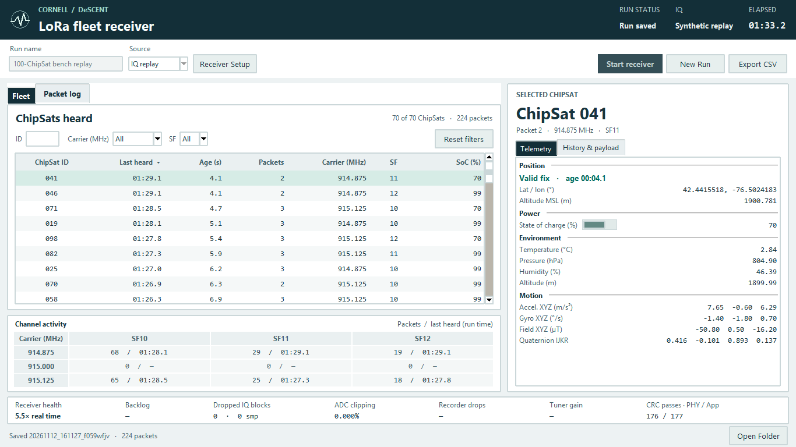

# DeSCENT LoRa fleet receiver

Windows receiver for one RTL-SDR. One 1 MS/s CU8 stream feeds SF10, SF11 and SF12 searches on each selected carrier. Live reception records IQ by default. File and live modes use the same decoder.

## First run in PowerShell

```powershell
Set-Location "$HOME\Desktop\DeSCENT_Comms\LoRa_SDR_Reciever"
.\setup.bat
.\run_gui.bat
```

For a first run without an SDR, open the bundled IQ in the same interface and click **Start receiver**.

```powershell
.\run_gui.bat --replay .\examples\epfl_bench.iq
```

The example lasts 10.25 seconds. The first three packets are CSID 1 at SF10, CSID 2 at SF11, and CSID 3 at SF12. CSIDs 2 and 3 then start together on carrier A. These are receiver-archive payloads modulated by the independent EPFL transmitter.

## At the bench



- Edit **Run name**, select **Live RTL-SDR** or **IQ replay**, and open **Receiver Setup**. The Radio tab shows the common tuner center, the 1 MS/s sample rate, occupied bandwidth, carrier choices and SF7–SF12. The Files tab selects the profile, replay recording and output parent. For the two radios on 915 MHz, leave **915.000**, **SF11** and **SF12** selected. The live GUI starts with **Auto-set gain before capture** enabled. It measures headroom once, applies the chosen tuner gain and holds it for the run. Clear the checkbox to enter a manual gain.
- Click **Start receiver**. The run bar shows recording or playback state and the capture clock. The health strip shows the DSP backlog, local IQ drops, ADC rail hits, applied gain and both CRC pass counts. Unpaced replay displays processing speed relative to real time. Each carrier/SF cell shows the number of decoded packets and the most recent preamble start on the capture clock.
- Select a fleet row to inspect it while packets arrive. Column headings sort numerically. **Last heard** puts the latest RF activity first. Packet age and position age use capture time and freeze at the end of replay. A 30-second-old packet is marked stale. The fleet accepts telemetry with a valid application CRC and a passing or absent PHY CRC. The packet log retains rejected and generic frames. A valid sensor zero is displayed as zero. A missing or invalid sensor reading is shown as a dash. A new packet without GPS fix retains the last valid coordinates and their age.
- **History & payload** shows the selected ChipSat’s last 12 trusted packets and its latest raw bytes. **Packet log** displays up to 300 packets and supports pause-autoscroll, copy row and clear view. ID, carrier and SF filters apply to latest observations in the fleet and individual rows in the packet log. **Score with TX log** becomes available after the run. It asks for the TX-to-capture clock offset and displays PRR only when the record supplies a positive transmission count.
- **Export CSV** defaults to every packet in the run. The other choices export packets matching the current filters or one summary row per heard ChipSat. Exports stream from the disk journal, including older and cleared display rows. During capture an export takes the committed prefix through the latest receiver update. The footer gives the filename and **Open Folder** opens its location.
- **Stop receiver** finishes the current run. **New Run** also works during capture or export. It waits for outstanding work, creates a new run ID and folder, and resets fleet, log, filters, PRR and counters. Radio and recording settings carry over. Earlier recordings and exports remain in their original folders.

Setup uses Python 3.11+ with Tk on Windows and a project-local virtual environment. It checks for usable installed packages first. If required it installs the packages in `requirements.txt` into that environment. This installation was exercised with Python 3.13.17, NumPy 2.5.4, SciPy 1.18.1 and lora-phy 0.3.0. For live use, install the RTL-SDR USB driver and an `rtl_tcp.exe` compatible with your device. The launcher finds it on PATH, in radioconda, or at the path in `RTL_TCP_EXE`. `receiver.bat doctor` prints the resolved executable. Each local live run starts and owns its own localhost server. Use `--connect HOST:PORT` only for a server you intend to tune and control.

```powershell
.\run_live.bat --gain 10 --ppm 0 --seconds 45
.\run_acceptance.bat --quick
.\run_acceptance.bat
```

**Quick** runs the software tests, the EPFL fixture and nine concurrent transmissions. Full acceptance also generates the signed power sweep and the 100-node fleet, runs paired SIC comparisons, and paces the same fleet IQ through a local TCP socket. Allow about 1 GB of free space for its fixtures and recording. The full run needs permission to use loopback TCP. To repeat just the paced stage, use `run_acceptance.bat --paced-from <acceptance-folder>`. It uses the profile saved with that run. [Measured acceptance results](VALIDATION.md)

## Carrier and tuner frequencies

The three profile carriers are selected on startup. **Receiver Setup** also accepts more frequencies in **Additional MHz**, separated by commas or spaces. Use **New Run** to change the monitored channels between captures.

**Capture center MHz** tunes the single live SDR. All selected channels must fit in its capture bandwidth. For replay, the IQ sidecar supplies actual tuning when present. Without a sidecar the capture center field supplies it. The CLI accepts the same selections in Hz. For example, these commands listen to 915 MHz alone and replay a recording on two selected carriers.

```powershell
.\run_live.bat --carriers 915000000
.\replay_iq.bat .\examples\epfl_bench.iq --carriers 914875000 915125000
```

## Radio settings and scope of confirmation

| Setting | First bench profile |
|---|---|
| Tuner and capture | 915.000 MHz, 1,000,000 complex samples/s, unsigned 8-bit I then Q |
| Monitored carrier centers | 914.875, 915.000 and 915.125 MHz |
| Fleet transmit allocation | 50 ChipSats each on A (914.875 MHz) and B (915.125 MHz), split 30/12/8 across SF10/11/12. The center channel has no assigned fleet nodes. |
| Occupied bandwidth | 125 kHz on each carrier |
| Sync / polarity | 0x12, normal IQ |
| Header / expected coding | Explicit, 4/7, PHY CRC enabled |
| Preamble | 8 unmodulated upchirps |
| LDRO | Auto, off at SF10 and on at SF11 and SF12 |
| CFO search | ±18 kHz per carrier |

The nominal occupied edges are 914.8125 and 915.1875 MHz. Capture edges are 914.500 and 915.500 MHz. Startup also checks each channel's CFO search margin. The RF frequencies and allocation are the operator's proposed plan. The bench PHY settings agree with the available RF Lab LoRa presets and were exercised with the independent transmitter. An earlier live capture logged seven SF11 and 21 SF12 packets on 915.000 MHz passing both CRCs. Flight register readback remains open. The explicit header supplies the received CR, payload length and PHY CRC presence for each frame. Sync is checked from IQ. Preamble length, header mode, LDRO and polarity are configured assumptions. [Live bench summary](runs/20261112_152240_6l7w8vt8/summary.json)

For physical confirmation, export one row per actual transmitter configuration, covering A and B at all three SFs. Readbacks on 915.000 MHz are optional and are checked if supplied. The default profile lists this carrier under `monitor_only_hz`. Use measured/read-back values for the columns below. `ldro` is the effective Boolean at that SF. Use 0x-prefixed hexadecimal or decimal for `sync_word`.

```csv
carrier_hz,sf,bandwidth_hz,sync_word,explicit_header,phy_crc,cr_denominator,preamble_symbols,ldro,invert_iq
```

```powershell
.\receiver.bat check-tx C:\RF_runs\radio_readback.csv
```

An incomplete or mismatched readback produces a nonzero exit and names the missing branches or differing fields. Edit a copy of [the profile](profiles/descent.json) for other settings. Both the GUI and CLI accept the copy. `--center`, `--carriers`, `--sfs` and `--bw` override a profile for a single run. This command listens to SF11 and SF12 on carrier A.

```powershell
.\run_live.bat --profile .\profiles\descent.json --carriers 914875000 --sfs 11 12 --gain 10
```

The decoder accepts SF7–SF12, integer Fs/(2·BW), implicit or explicit headers, CR 4/5–4/8, configurable sync word and polarity. The tested mission bandwidth is 125 kHz. For a different bandwidth, set `max_cfo_hz` to a positive value below BW/4. Oscillator error and Doppler add to the received offset. A contact with predicted offsets above the default needs a wider validated profile or updated tuning. Settings with occupied bandwidth or search margin outside the captured band are rejected.

## Bench acceptance

1. **Read back the radios and obtain a common time reference.** Record radio IDs, per-radio SF, BW, CR, sync, header mode, CRC setting, preamble, LDRO and IQ polarity. Record receiver center, gain, ppm, splitter/attenuator settings, transmit-start log and the offset between TX-log time zero and the first recorded IQ pair. A known isolated reference burst can establish this offset.
2. **Capture isolated controls.** Use carrier A, a known 55-byte payload at each of SF10, SF11 and SF12 and a fresh packet counter per transmission. Start the receiver before the first preamble and leave at least four seconds after the last start. Check the bytes and both CRCs. Also use the generic packet CSV for other payload lengths.
3. **Repeat the demonstrated equal-power comparison.** Put SF11 and SF12 on A, start their preambles together, and keep tuner gain fixed. Use separate transmitter attenuation or calibrated RF-path attenuation to change relative level. Both signals reach the same ADC. Use an initial `--auto-gain` run if desired and then hold the reported gain throughout the comparison. Inspect rail hits during representative bursts.
4. **Sweep relative received power.** At fixed gain capture weaker-alone, stronger-alone and overlapped packets at signed differences 0, ±6, ±12, ±18, ±24 and ±30 dB. Positive means SF11 stronger. Measure each signal alone at the receiver input or estimate its relative level from isolated preambles. Retain only individually decodable weak levels when interpreting masking loss. Repeat each setting with independent phase/start offsets and packet counters. Preserve clips and misses in the record.
5. **Run all nine branches, then the fleet.** Check one known packet on every carrier/SF combination concurrently. For the 100-node trial, offer one packet per ChipSat per 30 s using the 30/12/8 split on A and B. Capture at least three complete periods plus leading/trailing margin. Include all offered packets in the transmit CSV. Record for at least 100 s for a 90 s trial and log the capture-to-TX offset. More periods and power realizations are needed for a field recovery estimate.

These commands create a unique live folder, locate its recording and run both decodes on identical IQ. Start the capture before initiating the transmitter sequence. Supply the actual TX CSV and measured clock offset for scoring.

```powershell
.\run_live.bat --gain 10 --ppm 0 --seconds 100 --out .\runs\bench_capture
$captureRun = Get-ChildItem .\runs\bench_capture -Directory | Sort-Object Name | Select-Object -Last 1
$iq = Join-Path $captureRun.FullName 'capture.iq'
.\replay_iq.bat "$iq" --out .\runs\bench_primary
.\replay_iq.bat "$iq" --sic --out .\runs\bench_sic
$primary = Get-ChildItem .\runs\bench_primary -Directory | Sort-Object Name | Select-Object -Last 1
$sic = Get-ChildItem .\runs\bench_sic -Directory | Sort-Object Name | Select-Object -Last 1
$offset = [double](Read-Host 'Seconds from capture start to TX log zero')
.\receiver.bat score "$($primary.FullName)" C:\RF_runs\truth.csv --offset-s $offset
.\receiver.bat score "$($sic.FullName)" C:\RF_runs\truth.csv --offset-s $offset
```

## Capture, replay and exports

Packet rows include `run_id`, `run_name`, `receive_utc` and `timestamp_source`. Live receive UTC uses the host capture start plus the RF sample offset. Replay uses the recorded UTC start when available. For an older recording without that timestamp, `replay_decode_utc` identifies the UTC at which this replay decoded the packet. Use `capture_s` to compare transmissions in every case. GUI exports also flatten valid telemetry into engineering-unit columns and include the parser’s validity flags. Empty CSV cells distinguish unavailable data from a measured zero.

The health strip shows the most recently processed block’s ADC clipping. The live status line shows the peak. The saved summary includes both the peak block fraction and the clipping fraction across the full run. The backlog history retains the latest 4,096 observations for long sessions.

- `capture.iq` is the original RTL CU8 stream. `capture.iq.json` contains tuning, recording byte counts, gaps and SHA-256. The asynchronous recorder receives bytes before the DSP queue. A full DSP queue can therefore lose a live decode while leaving the original recording intact. Disk recorder losses have their own counters. A recording stop/error is recorded in its sidecar and run summary.
- A reference-style `.iq.json` is read automatically. `center_hz` gives actual tuning. Without a sidecar the profile supplies tuning and sample rate. Replay interprets recorder `file_offset` and `dropped_bytes` as byte counts, skips parity padding, resets filters and pending bursts at gaps, and advances the RF clock. Truncated/unpaired samples are unavailable. Pair a recorded file with its own sidecar.
- `packets.csv` includes the original payload bytes as hex, capture-relative preamble start in complex samples and seconds, carrier, SF, parsed coding rate, estimated frequency offset/drift, coherent preamble level in dBFS, both CRC outcomes, CSID, counter and decoded telemetry JSON. Empty CRC indicates absent PHY CRC or inapplicable application format. Every 55-byte record gets the flight application CRC check. Engineering-unit fields are published only when that CRC passes. Temperature, pressure, counts, GNSS, quaternion and validity-bit conversions come from the receiver-side flight parser.
- `summary.json` contains per-branch activity, rejected headers, clipping, queue backlog, processed samples, locally known dropped samples, incomplete bursts and run timing. A rail hit means either I or Q equals 0 or 255. The preamble level is a digital estimate. Absolute input dBm requires calibration. Stock rtl_tcp has no sequence counter for upstream USB loss. That field stays unknown. The live backlog is the difference between reader and processed sample positions. A slope above 0.01 s/s with a rise above 0.13 s between the first and last three readings flags growth after at least five seconds. Review the history for shorter transients.
- SIC produces `packets_primary.csv`, `packets_residual.csv` and a merged `packets.csv`. The original IQ remains the input for both passes. Donors require positive PHY CRC and, for a 55-byte packet, positive application CRC. The prototype re-encodes the validated bytes, reconstructs the preamble, sync, SFD and data chirps, applies measured RF offset, slew and sample-clock correction, fits complex gain to each symbol/block segment, and subtracts only supported fits. It reruns the entire blind search on the residual and merges detections by branch, sample time and payload. SIC operates on replay.
- Scoring is a separate command. Supply CSV `start_s,payload_hex` and preferably `channel_frequency_hz,sf` plus `node_id`. The receiver also recognizes `scheduled_start_s`, `scheduled_payload_hex`, `tx_start_s`, `carrier_hz` and `chipsat_id`. The default tolerance is 50 ms. Use `--tolerance-s` to change it. A match requires exact bytes, a positive PHY CRC, a valid application CRC for telemetry, the specified branch and a time match. One transmission can score once. `matches.csv` records matches, extra duplicates, unmatched valid decodes and rejected rows. `score.json` reports false/duplicate counts and unique valid IDs per TX-aligned 30 s period, including empty periods. Only complete periods enter the fraction reaching 80. Raw summaries use capture-aligned periods. False and duplicate counts require truth.

## Decoder choice and attribution

The production receiver combines a sample-indexed NumPy/SciPy front end with the pinned pyLoRaPHY 0.3.0 packet codec. This gives each SF an independent preamble search, keeps timestamp and gap handling in the same clock as capture, and supports offline reconstruction from decoded bytes. Compiled FFT and polyphase filtering carry the continuous workload. Python handles the decoded bursts and reporting. The measured fleet throughput and independent interoperability fixture are in the validation report. No head-to-head sensitivity benchmark against EPFL or the bench radios was performed. [Validation](VALIDATION.md)

- **pyLoRaPHY / lora-phy 0.3.0**, Zhang Maiyun and Rohith Reddy Vennam (package metadata). Installed as a dependency. Its Gray mapping, deinterleaving, Hamming decoding, dewhitening, checksum and coding routines supply the packet codec. Its encoder supplies reconstruction symbols. `phy.py` contains the version-specific adapter. pyLoRaPHY credits the original MATLAB LoRaPHY by jkadbear, © 2020–2022, MIT. Xu, Xie, Tong and Wang describe that PHY implementation in *From Demodulation to Decoding: Towards Complete LoRa PHY Understanding and Implementation*, ACM TOSN, 2022. [Package and authors](https://pypi.org/project/lora-phy/0.3.0/) · [Original LoRaPHY and paper](https://github.com/jkadbear/LoRaPHY)
- **EPFL gr-lora_sdr**, Telecommunication Circuits Laboratory. The project credits J. Tapparel, O. Afisiadis, P. Mayoraz, A. Balatsoukas-Stimming and A. Burg for *An Open-Source LoRa Physical Layer Prototype on GNU Radio*, SPAWC 2020. The tested GNU Radio 3.10.12.0 installation has upstream commit `a8143cb6162e0ee0677531aec36ca5f05fd678e0` (radioconda build `0.0.0.20250305.dev+ga8143cb`). Only the optional fixture generator uses these compiled EPFL blocks. Its binary input and bounded file-output wiring adapt the upstream transmitter flowgraph. That script carries its GPL notice and the GPL text is included. The shipped example is IQ data generated by this transmitter. [Pinned upstream](https://github.com/tapparelj/gr-lora_sdr/tree/a8143cb6162e0ee0677531aec36ca5f05fd678e0) · [Upstream license](https://github.com/tapparelj/gr-lora_sdr/blob/a8143cb6162e0ee0677531aec36ca5f05fd678e0/LICENSE) · [2020 paper](https://arxiv.org/abs/2002.08208) · [Included GPL](licenses/GPL-3.0.txt)
- **Synchronization method.** Joachim Tapparel and Andreas Burg, *Design and Implementation of LoRa Physical Layer in GNU Radio*, 2024, describe dechirp/FFT decisions and preamble-based time/frequency separation. Our streaming search, opposite-slope timing estimates, per-SF phase projection, drift/clock tracking, CRC-gated retry, channelization and cancellation are implemented here. EPFL's receiver code is outside the production dependency chain. [Tapparel and Burg, 2024](https://events.gnuradio.org/event/24/contributions/641/attachments/192/478/paper_tapparel.pdf)
- **DeSCENT LR-FHSS Fleet Receiver**, Mark Lohatepanont, © 2026, MIT. Receiver snapshot `53fe070a35ba3a8124ee050c7334b2081cc545e9`. `telemetry.py` extracts the V2.5 flight decoder. `iq_recorder.py` adapts its async recorder with exclusive file creation and hashing. `gain.py` adapts its tuner table, ADC headroom and one-shot gain scan, omitting the LR-FHSS trigger calculation. Capture control, LoRa-specific DSP, GUI, scoring, exports, tests and launchers are part of this project. Neither neighboring project is loaded or edited by these tools. [Preserved MIT notice](licenses/DeSCENT-MIT.txt)

Rebuild the independent fixture on a host with the matching EPFL radioconda package.

```powershell
.\.venv\Scripts\python.exe -B tools\make_interop.py --python C:\ProgramData\radioconda\python.exe --out .\runs\regenerated\epfl_bench.iq
```
